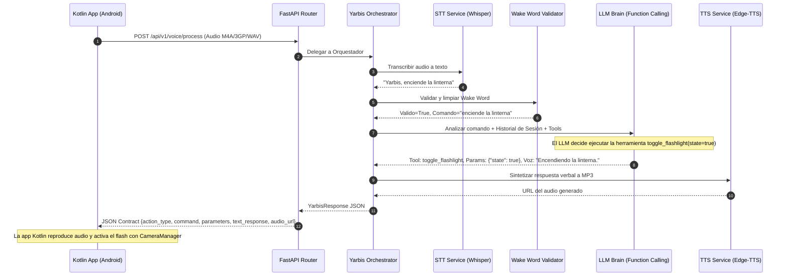

# Yarbis - Asistente de Voz Inteligente (Backend FastAPI)

Arquitectura backend desacoplada, asíncrona y modular diseñada para servir como el cerebro del asistente móvil de voz **Yarbis**, desarrollado en **Kotlin (Android)**.

---

## 🏛️ Arquitectura del Sistema

El backend sigue una arquitectura limpia orientada a servicios, donde cada responsabilidad se encuentra estrictamente delimitada:

```
Yarbis/
├── app/
│   ├── main.py                     # Configuración de FastAPI, middlewares CORS, eventos de ciclo de vida
│   ├── core/
│   │   ├── config.py               # Configuración centralizada vía Pydantic Settings y .env
│   │   ├── prompts.py              # Personalidad, directrices y System Prompt de Yarbis
│   │   └── wake_word.py            # Validador de Wake Word ("Yarbis") y normalizador fonético
│   ├── schemas/
│   │   ├── common.py               # Enums (ActionType, DeviceCommand)
│   │   ├── request.py              # Esquemas de solicitud para comandos y voz
│   │   ├── response.py             # Contrato de respuesta estándar para Kotlin / Android
│   │   └── tools.py                # Definición de herramientas de Function Calling (OpenAI Tools)
│   ├── services/
│   │   ├── session_service.py      # Gestor de memoria de sesión (TTL y ventana deslizante)
│   │   ├── stt_service.py          # Transcripción de audio (Whisper OpenAI / Mock)
│   │   ├── tts_service.py          # Síntesis de voz (Edge-TTS sin costo / OpenAI TTS)
│   │   ├── llm_service.py          # Cerebro LLM con Function Calling y motor local de contingencia
│   │   └── orchestrator.py         # Orquestador del flujo end-to-end
│   ├── api/
│   │   ├── router.py               # Enrutador principal v1 y healthcheck
│   │   └── v1/
│   │       ├── command.py          # POST /api/v1/command/process (texto directo)
│   │       ├── voice.py            # POST /api/v1/voice/process & GET /api/v1/voice/audio/{file}
│   │       └── session.py          # GET /api/v1/session/{id}/history & DELETE /api/v1/session/{id}
│   └── utils/
│       └── audio.py                # Utilidades de guardado temporal, nombrado y limpieza
├── clients/
│   ├── kotlin/                     # Clases cliente listas para producción en Kotlin / Android
│   │   ├── YarbisResponse.kt       # Modelos Data Class de respuesta
│   │   ├── YarbisApiService.kt     # Cliente HTTP con Coroutines y OkHttp (Multipart y JSON)
│   │   ├── DeviceActionHandler.kt  # Manejador nativo de audio y hardware de Android
│   │   ├── YarbisOverlayBubble.kt  # Burbuja flotante oculta (Overlay) con animación y estados
│   │   ├── WakeWordDetector.kt     # Detector de Wake Word ("Yarbis") y grabador en background
│   │   ├── YarbisVoiceService.kt   # Foreground Service para escucha fuera de la app
│   │   ├── YarbisPermissionsHelper.kt # Gestor de permisos (Overlay y Micrófono)
│   │   └── AndroidManifest_Snippet.xml # Permisos y configuración de manifiesto
│   └── desktop/
│       └── yarbis_bubble_client.py # Cliente de escritorio con burbuja flotante HUD para PC
├── static/
│   └── audio/                      # Almacenamiento en caché de audios sintetizados
├── tests/
│   ├── test_wake_word.py           # Pruebas unitarias de detección fonética del Wake Word
│   └── test_api.py                 # Pruebas de integración de endpoints (REST y multipart)
├── .env.example                    # Plantilla de variables de entorno
├── requirements.txt                # Dependencias de producción y pruebas
└── README.md                       # Documentación y Guía de Integración Kotlin / Android
```

---

## 🔄 Flujo de Procesamiento



---

## ⚙️ Puesta en Marcha Rápida

### 1. Requisitos Previos
* Python 3.10 o superior.

### 2. Instalación de Dependencias
```bash
# Crear entorno virtual
python -m venv venv

# Activar entorno (Windows PowerShell)
.\venv\Scripts\Activate.ps1

# Activar entorno (Linux/macOS)
source venv/bin/activate

# Instalar librerías
pip install -r requirements.txt
```

### 3. Configuración de Variables de Entorno
Copia el archivo `.env.example` a `.env`:
```bash
cp .env.example .env
```
Edita `.env` con tus preferencias:
* `OPENAI_API_KEY`: Tu clave de OpenAI (si no se especifica, el sistema activa automáticamente un motor de contingencia local que permite pruebas funcionales sin gastar saldo).
* `TTS_PROVIDER`: Por defecto `edge_tts` (utiliza voces neuronales en español de alta calidad de forma gratuita, sin requerir credenciales de API).
* `REQUIRE_WAKE_WORD`: `False` (ideal para botones Push-to-Talk en la app Android/Kotlin) o `True` (para requerir que el usuario diga "Yarbis" al inicio).

### 4. Iniciar el Servidor
```bash
uvicorn app.main:app --host 0.0.0.0 --port 8000 --reload
```

Accede a la documentación interactiva Swagger en:
**http://localhost:8000/docs**

---

## 📡 Contrato de la API para Kotlin / Android

### 1. Formato Estándar de Respuesta (`YarbisResponse`)

Todas las respuestas del backend entregan la siguiente estructura JSON uniforme:

```json
{
  "action_type": "device_control | conversational_query",
  "command": "nombre_de_la_accion_o_null",
  "parameters": {
    "clave": "valor"
  },
  "text_response": "Texto de respuesta verbal de Yarbis",
  "audio_url": "/api/v1/voice/audio/yarbis_abc123.mp3",
  "audio_base64": "UklGRiQAAABXQVZFZm10... (opcional, reproducción instantánea)",
  "transcription": "Texto transcrito del audio (si vino de voz)",
  "session_id": "session_id_del_usuario"
}
```

> **Nota sobre URLs de Audio y Conectividad Android:**
> El backend devuelve por defecto una URL **relativa** (`/api/v1/voice/audio/...`) para evitar que el enlace quede anclado rígidamente a `localhost` o `10.0.2.2`, permitiendo que el cliente en Kotlin le anteponga dinámicamente el `baseUrl` configurado en el móvil (incluso en emuladores con `http://10.0.2.2:8000` o en dispositivos físicos por Wi-Fi como `http://192.168.1.X:8000`). Adicionalmente, puede solicitar `include_audio_base64=true` para obtener el audio directamente en memoria y reproducirlo sin realizar una segunda petición HTTP.

---

### 2. Catálogo de Comandos de Control de Dispositivo (`device_control`)

Cuando `action_type == "device_control"`, la app en Kotlin debe inspeccionar el campo `command` y extraer los parámetros correspondientes para ejecutar la acción nativa en Android:

| `command` | Parámetros (`parameters`) | Ejemplo de Solicitud | Acción en Kotlin (Android Native) |
| :--- | :--- | :--- | :--- |
| **`toggle_flashlight`** | `state: bool` (true/false) | *"Enciende la linterna"* | `CameraManager.setTorchMode(cameraId, state)` |
| **`set_brightness`** | `level_percent: int` (0-100) | *"Pon el brillo al 80%"* | `Settings.System.putInt(contentResolver, SCREEN_BRIGHTNESS, ...)` o `window.attributes.screenBrightness` |
| **`set_volume`** | `level_percent: int`, `stream: str` | *"Sube el volumen al 70%"* | `AudioManager.setStreamVolume(STREAM_MUSIC, target, ...)` |
| **`toggle_wifi`** | `state: bool` | *"Desactiva el Wi-Fi"* | `Intent(Settings.ACTION_WIFI_SETTINGS)` |
| **`toggle_bluetooth`** | `state: bool` | *"Activa el bluetooth"* | `Intent(Settings.ACTION_BLUETOOTH_SETTINGS)` |
| **`set_alarm`** | `time: str` (HH:MM), `label: str` | *"Pon una alarma a las 7:00 AM"* | `Intent(AlarmClock.ACTION_SET_ALARM)` con `EXTRA_HOUR` y `EXTRA_MINUTES` |
| **`cancel_alarm`** | `time: str`, `label: str` | *"Cancela la alarma de las 7"* | `Intent(AlarmClock.ACTION_DISMISS_ALARM)` |
| **`set_timer`** | `duration_seconds: int`, `label: str` | *"Temporizador de 5 minutos"* | `Intent(AlarmClock.ACTION_SET_TIMER)` con `EXTRA_LENGTH` |
| **`cancel_timer`** | `label: str` | *"Detén el temporizador"* | `Intent(AlarmClock.ACTION_SHOW_TIMERS)` |
| **`set_reminder`** | `title: str`, `datetime_iso: str` | *"Recuérdame comprar leche mañana a las 10"* | `Intent(Intent.ACTION_INSERT, Events.CONTENT_URI)` o notificación `WorkManager` |
| **`open_app`** | `app_name: str`, `package_name: str` | *"Abre Spotify"* | `packageManager.getLaunchIntentForPackage(pkg)` |
| **`make_phone_call`** | `contact_name: str`, `phone_number: str` | *"Llama a Mamá"* | `Intent(Intent.ACTION_DIAL, Uri.parse("tel:$phone"))` |
| **`send_message`** | `recipient: str`, `message_body: str`, `app: str` | *"Manda un WhatsApp a Juan diciendo que llego tarde"* | `Intent(Intent.ACTION_VIEW, Uri.parse("https://api.whatsapp.com/send?..."))` |

---

### 3. 🧠 Gestión de Memoria y Contexto Conversacional (`session_id`)

El backend de Yarbis implementa un motor de **memoria conversacional atado al `session_id`** con política de ventana deslizante y expiración TTL:

#### A. Preguntas de Seguimiento y Anáforas (Sin Repetir el Sujeto)
El usuario puede formular preguntas sucesivas de forma natural:
* **Turno 1:** *"¿Cómo está el clima en Monterrey?"* ➔ Yarbis: *"En Monterrey se registran actualmente 22°C con cielo despejado."*
* **Turno 2:** *"¿y para mañana?"* ➔ Yarbis deduce automáticamente el sujeto *"Monterrey"* y responde con el pronóstico de mañana para Monterrey.
* **Turno 3:** *"¿y en París?"* ➔ Yarbis conserva el tema del clima y responde con las condiciones en París.

#### B. Modificaciones Contextuales de Hardware y Comandos
* **Turno 1:** *"Pon una alarma a las 7:00"* ➔ Yarbis programa alarma para las 07:00.
* **Turno 2:** *"Cámbiala a las 8:00"* ➔ Yarbis actualiza la alarma sin que el usuario tenga que repetir la palabra *"alarma"*.

#### C. Endpoints de Consulta y Control de Memoria:
| Método | Endpoint | Descripción |
| :--- | :--- | :--- |
| `GET` | `/api/v1/session/{session_id}/history` | Inspecciona el historial completo de mensajes y turnos. |
| `GET` | `/api/v1/session/{session_id}/context` | Consulta las variables semánticas activas (último tema, entidad, comando). |
| `DELETE` | `/api/v1/session/{session_id}` | Reinicia la memoria de la sesión para comenzar una nueva conversación limpia. |
| `GET` | `/api/v1/session` | Lista todas las sesiones activas en el backend. |

---

## 📱 Guía de Integración en Kotlin (Android)

Los archivos fuente listos para usar en proyectos de **Android Studio** se encuentran disponibles en la carpeta [`clients/kotlin/`](file:///C:/Proyectos/Python/Yarbis/clients/kotlin):
* [`YarbisResponse.kt`](file:///C:/Proyectos/Python/Yarbis/clients/kotlin/YarbisResponse.kt): Modelos de datos con Gson / Kotlin Data Classes.
* [`YarbisApiService.kt`](file:///C:/Proyectos/Python/Yarbis/clients/kotlin/YarbisApiService.kt): Cliente de red asíncrono basado en Coroutines y OkHttp (soporte Multipart para audio y JSON para comandos).
* [`DeviceActionHandler.kt`](file:///C:/Proyectos/Python/Yarbis/clients/kotlin/DeviceActionHandler.kt): Despachador de acciones nativas del sistema operativo Android y reproductor de audio (`MediaPlayer`).

### 1. Dependencias recomendadas en `build.gradle.kts` (app):
```kotlin
dependencies {
    // Red y JSON
    implementation("com.squareup.okhttp3:okhttp:4.12.0")
    implementation("com.google.code.gson:gson:2.10.1")

    // Coroutines
    implementation("org.jetbrains.kotlinx:kotlinx-coroutines-android:1.8.0")
}
```

---

### 2. Modelo de Respuesta en Kotlin: `YarbisResponse.kt`

```kotlin
package com.yarbis.client.model

import com.google.gson.annotations.SerializedName

enum class ActionType {
    @SerializedName("device_control")
    DEVICE_CONTROL,

    @SerializedName("conversational_query")
    CONVERSATIONAL_QUERY
}

data class YarbisResponse(
    @SerializedName("action_type")
    val actionType: ActionType,

    @SerializedName("command")
    val command: String? = null,

    @SerializedName("parameters")
    val parameters: Map<String, Any?> = emptyMap(),

    @SerializedName("text_response")
    val textResponse: String,

    @SerializedName("audio_url")
    val audioUrl: String? = null,

    @SerializedName("audio_base64")
    val audioBase64: String? = null,

    @SerializedName("transcription")
    val transcription: String? = null,

    @SerializedName("session_id")
    val sessionId: String? = null
)
```

---

### 3. Servicio de Peticiones en Kotlin: `YarbisApiService.kt`

Permite enviar tanto audio capturado por el micrófono (`MediaRecorder` o `AudioRecord`) como comandos de texto:

```kotlin
package com.yarbis.client.network

import com.google.gson.Gson
import com.yarbis.client.model.YarbisResponse
import kotlinx.coroutines.Dispatchers
import kotlinx.coroutines.withContext
import okhttp3.MediaType.Companion.toMediaType
import okhttp3.MultipartBody
import okhttp3.OkHttpClient
import okhttp3.Request
import okhttp3.RequestBody.Companion.asRequestBody
import okhttp3.RequestBody.Companion.toRequestBody
import java.io.File
import java.io.IOException

class YarbisApiService(
    // 10.0.2.2 en emulador Android Studio. En teléfono físico usa la IP de tu PC (ej. http://192.168.1.50:8000)
    val baseUrl: String = "http://10.0.2.2:8000"
) {
    private val gson = Gson()
    private val client = OkHttpClient()

    /**
     * Envía audio grabado (.m4a, .wav, .3gp, etc.) al endpoint POST /api/v1/voice/process
     */
    suspend fun processVoiceAudio(
        audioFile: File,
        sessionId: String = "mobile_kotlin_01",
        requireWakeWord: Boolean = false,
        generateAudio: Boolean = true,
        includeAudioBase64: Boolean = true
    ): Result<YarbisResponse> = withContext(Dispatchers.IO) {
        try {
            val mimeType = when (audioFile.extension.lowercase()) {
                "wav" -> "audio/wav"
                "3gp" -> "video/3gpp"
                "aac" -> "audio/aac"
                "mp3" -> "audio/mpeg"
                else -> "audio/m4a"
            }

            val requestBody = MultipartBody.Builder()
                .setType(MultipartBody.FORM)
                .addFormDataPart("file", audioFile.name, audioFile.asRequestBody(mimeType.toMediaType()))
                .addFormDataPart("session_id", sessionId)
                .addFormDataPart("require_wake_word", requireWakeWord.toString())
                .addFormDataPart("generate_audio", generateAudio.toString())
                .addFormDataPart("include_audio_base64", includeAudioBase64.toString())
                .build()

            val request = Request.Builder()
                .url("${baseUrl.trimEnd('/')}/api/v1/voice/process")
                .post(requestBody)
                .build()

            client.newCall(request).execute().use { response ->
                if (!response.isSuccessful) {
                    return@withContext Result.failure(IOException("Error HTTP ${response.code}"))
                }
                val body = response.body?.string() ?: return@withContext Result.failure(IOException("Cuerpo vacío"))
                Result.success(gson.fromJson(body, YarbisResponse::class.java))
            }
        } catch (e: Exception) {
            Result.failure(e)
        }
    }

    /**
     * Envía un comando en texto directo al endpoint POST /api/v1/command/process
     */
    suspend fun processTextCommand(
        text: String,
        sessionId: String = "mobile_kotlin_01",
        requireWakeWord: Boolean = false,
        generateAudio: Boolean = true,
        includeAudioBase64: Boolean = false
    ): Result<YarbisResponse> = withContext(Dispatchers.IO) {
        try {
            val jsonPayload = gson.toJson(
                mapOf(
                    "text" to text,
                    "session_id" to sessionId,
                    "require_wake_word" to requireWakeWord,
                    "generate_audio" to generateAudio,
                    "include_audio_base64" to includeAudioBase64
                )
            )
            val requestBody = jsonPayload.toRequestBody("application/json; charset=utf-8".toMediaType())

            val request = Request.Builder()
                .url("${baseUrl.trimEnd('/')}/api/v1/command/process")
                .post(requestBody)
                .build()

            client.newCall(request).execute().use { response ->
                if (!response.isSuccessful) {
                    return@withContext Result.failure(IOException("Error HTTP ${response.code}"))
                }
                val body = response.body?.string() ?: return@withContext Result.failure(IOException("Cuerpo vacío"))
                Result.success(gson.fromJson(body, YarbisResponse::class.java))
            }
        } catch (e: Exception) {
            Result.failure(e)
        }
    }
}
```

---

### 4. Manejador de Acciones de Dispositivo en Android: `DeviceActionHandler.kt`

```kotlin
package com.yarbis.client.handler

import android.content.Context
import android.content.Intent
import android.hardware.camera2.CameraManager
import android.media.MediaPlayer
import android.net.Uri
import android.provider.AlarmClock
import android.util.Base64
import com.yarbis.client.model.ActionType
import com.yarbis.client.model.YarbisResponse
import java.io.File
import java.io.FileOutputStream

class DeviceActionHandler(
    private val context: Context,
    private val baseUrl: String = "http://10.0.2.2:8000"
) {
    private var mediaPlayer: MediaPlayer? = null

    fun handleResponse(response: YarbisResponse) {
        // 1. Reproducir audio de respuesta (Base64 instantáneo o URL)
        if (!response.audioBase64.isNullOrEmpty()) {
            val bytes = Base64.decode(response.audioBase64, Base64.DEFAULT)
            val tempFile = File.createTempFile("tts_", ".mp3", context.cacheDir)
            FileOutputStream(tempFile).use { it.write(bytes) }
            mediaPlayer?.release()
            mediaPlayer = MediaPlayer().apply {
                setDataSource(tempFile.absolutePath)
                prepare()
                start()
                setOnCompletionListener { tempFile.delete() }
            }
        } else if (!response.audioUrl.isNullOrEmpty()) {
            val url = if (response.audioUrl.startsWith("http")) response.audioUrl else "$baseUrl${response.audioUrl}"
            mediaPlayer?.release()
            mediaPlayer = MediaPlayer().apply {
                setDataSource(url)
                prepareAsync()
                setOnPreparedListener { start() }
            }
        }

        // 2. Control de hardware si aplica
        if (response.actionType != ActionType.DEVICE_CONTROL || response.command == null) return

        val params = response.parameters
        when (response.command) {
            "toggle_flashlight" -> {
                val state = params["state"] as? Boolean ?: false
                val cm = context.getSystemService(Context.CAMERA_SERVICE) as? CameraManager
                cm?.cameraIdList?.firstOrNull()?.let { cm.setTorchMode(it, state) }
            }
            "make_phone_call" -> {
                (params["phone_number"] as? String)?.let { phone ->
                    context.startActivity(Intent(Intent.ACTION_DIAL, Uri.parse("tel:$phone")).apply {
                        flags = Intent.FLAG_ACTIVITY_NEW_TASK
                    })
                }
            }
            "send_message" -> {
                val message = Uri.encode(params["message_body"] as? String ?: "")
                context.startActivity(Intent(Intent.ACTION_VIEW, Uri.parse("https://api.whatsapp.com/send?text=$message")).apply {
                    flags = Intent.FLAG_ACTIVITY_NEW_TASK
                })
            }
            "set_alarm" -> {
                val parts = (params["time"] as? String ?: "08:00").split(":")
                context.startActivity(Intent(AlarmClock.ACTION_SET_ALARM).apply {
                    putExtra(AlarmClock.EXTRA_HOUR, parts.getOrNull(0)?.toIntOrNull() ?: 8)
                    putExtra(AlarmClock.EXTRA_MINUTES, parts.getOrNull(1)?.toIntOrNull() ?: 0)
                    putExtra(AlarmClock.EXTRA_MESSAGE, params["label"] as? String ?: "Alarma")
                    flags = Intent.FLAG_ACTIVITY_NEW_TASK
                })
            }
        }
    }
}
```

---

### 5. Escucha en Segundo Plano y Burbuja Flotante Oculta (Android Native)

Permite invocar a Yarbis diciendo su nombre en voz alta incluso cuando el usuario está en WhatsApp, navegando por la web, viendo un video o con la app cerrada:

1. **`YarbisVoiceService.kt`**: `ForegroundService` que se mantiene vivo en segundo plano y muestra una notificación persistente con `FOREGROUND_SERVICE_MICROPHONE`.
2. **`WakeWordDetector.kt`**: Monitorea continuamente el flujo acústico y detecta la palabra clave *"Yarbis"*. Al activarse, captura la orden hasta que el usuario guarda silencio.
3. **`YarbisOverlayBubble.kt`**: Burbuja flotante basada en `WindowManager` (`TYPE_APPLICATION_OVERLAY`):
   - **En reposo**: Permanece completamente invisible/oculta (`GONE` / opacidad 0).
   - **Al decir *"Yarbis"***: Aparece flotando en pantalla sobre cualquier aplicación con animación de pulso neón y el mensaje: *"🎙️ Yarbis escuchando solicitud..."*.
   - **Al terminar de hablar**: Cambia de color a *"⚡ Procesando orden..."*.
   - **Al recibir respuesta**: Muestra la respuesta en pantalla, reproduce el audio de voz sintetizado mediante `DeviceActionHandler` y ejecuta la acción en el hardware del teléfono.
   - **Auto-cierre**: Se oculta suavemente de nuevo de forma automática.

#### Iniciar el servicio desde tu `MainActivity.kt`:
```kotlin
// Iniciar servicio de escucha y burbuja flotante
YarbisVoiceService.start(
    context = this,
    baseUrl = "http://10.0.2.2:8000", // o la IP de tu PC en red local
    sessionId = "usuario_movil_01"
)
```

---

### 6. Cliente de Escritorio (Desktop) con Burbuja Flotante HUD (Python / Windows / Mac)

Para probar la experiencia de escucha en segundo plano y burbuja flotante oculta directamente en tu computadora:

```bash
# 1. Asegúrate de tener el servidor backend de Yarbis ejecutándose:
uvicorn app.main:app --host 0.0.0.0 --port 8000 --reload

# 2. En otra terminal, inicia el cliente de burbuja flotante:
python clients/desktop/yarbis_bubble_client.py
```

- La burbuja se iniciará oculta en segundo plano.
- En cuanto digas **"Yarbis"** por tu micrófono (por ejemplo: *"Yarbis, qué hora es?"* o simplemente *"Yarbis"*), la burbuja flotante aparecerá instantáneamente en la parte superior de tu pantalla con animación neón indicándote que te está escuchando.

---

## 🧪 Ejecución de Pruebas Automatizadas

El proyecto incluye pruebas completas que validan:
* La detección y normalización fonética del Wake Word ("Yarbis", "Jarvis", etc.).
* El endpoint de salud `/api/v1/health`.
* El procesamiento de texto y control de dispositivo `/api/v1/command/process`.
* El procesamiento de audio multipart `/api/v1/voice/process`.

Para ejecutar las pruebas:
```bash
.\venv\Scripts\pytest.exe -v
```
